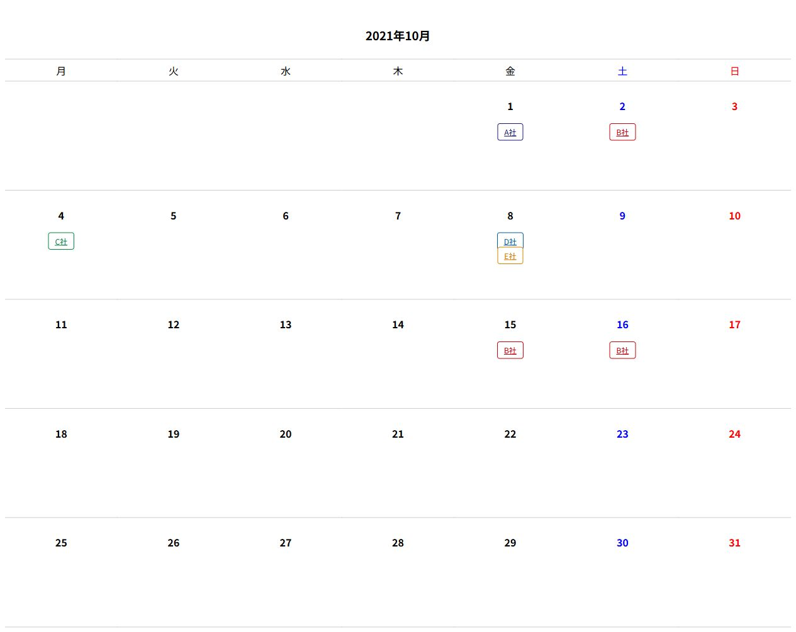

# calendar_to_call

月曜始まりの月間カレンダーに、会社名の予定リンクを表示するサンプルです。
ブラウザーで `index.html` を開くと、2021年10月のサンプルを表示します。
表示自体にNode.jsやnpmパッケージは必要ありません。

## 表示サンプル



`index.html` をブラウザーで開いた実際の表示です。
10月8日にはD社とE社の2件が並び、会社名をクリックするとアラートが表示されます。
画面幅やブラウザーによってフォントや余白は変わります。

## サンプルコード

### 同梱サンプルを開く

リポジトリをダウンロードし、`index.html` をブラウザーで開いてください。
表示年月と予定は [calendar-demo.js](calendar-demo.js) で変更できます。

### 自分のページに組み込む

次のHTMLを `calendar_to_call.js` と `calendar_to_call.css` と同じフォルダーに保存して開きます。
この例は上の画像から10月8日の2件を取り出したものです。
`calendar-demo.js` は読み込まず、このページ自身が予定を設定します。

```html
<!doctype html>
<html lang="ja">
  <head>
    <meta charset="UTF-8" />
    <meta name="viewport" content="width=device-width, initial-scale=1.0" />
    <title>予定カレンダー</title>
    <link rel="stylesheet" href="calendar_to_call.css" />
  </head>
  <body>
    <div id="calendar"></div>
    <script src="calendar_to_call.js"></script>
    <script>
      const calendarConfiguration = {
        ym: '2021/10',
        db: [
          {
            event_time: '2021/10/08',
            corp_name: 'D社',
            class_name: 'blue',
            js_function: "javascript:alert('D社');",
          },
          {
            event_time: '2021/10/08',
            corp_name: 'E社',
            class_name: 'orange',
            js_function: "javascript:alert('E社');",
          },
        ],
      };

      const calendarContainer = document.getElementById('calendar');
      if (calendarContainer) {
        calendarContainer.insertAdjacentHTML(
          'beforeend',
          setCalendar(calendarConfiguration),
        );
      }
    </script>
  </body>
</html>
```

スクリプトを表示先のdiv要素より後に置くことで、要素が存在してから描画します。
現在の年月を表示する場合は `ym` を省略し、予定の日付も表示対象の年月に合わせてください。
`js_function` に指定する処理は、ページ側で管理する固定のコードに限定してください。

## ファイルの役割

- `calendar_to_call.js`: 年月と予定を受け取り、カレンダーのHTMLを生成します。
- `calendar-demo.js`: サンプル予定を定義し、生成したHTMLをDOMに挿入します。
- `calendar_to_call.css`: カレンダーと予定リンクの見た目を定義します。
- `calendar_to_call.test.cjs`: Node.js標準機能による回帰テストです。

## API

`setCalendar({ ym, db })` はHTML文字列を返します。
`ym` は `YYYY/MM` 形式で、省略すると現在の年月になります。
`db` は予定の配列で、省略できます。
予定の各フィールドはJavaScript内のJSDocで説明しています。

会社名と属性はHTMLエスケープしますが、リンク先の安全性検証は行いません。
`js_function` はJavaScriptも実行できる既存仕様なので、信頼できるコードで指定してください。
外部入力をそのまま渡す用途には対応していません。

## 開発とチェック

開発ツールにはNode.js 24以降とnpmを使用します。
ESLint、Prettier、JSDoc型検査用のTypeScriptは開発時だけの依存です。

```sh
npm ci
npm run check
```

- `npm run lint`: ESLint推奨ルールでJavaScriptを検査。
- `npm run format`: HTML、CSS、JavaScript、設定、文書をPrettierで整形。
- `npm run format:check`: 整形の差分を検査。
- `npm run typecheck`: ブラウザー用JavaScriptのJSDoc型を検査。
- `npm test`: 回帰テストを実行。

整形ルールはPrettier、コードの問題検出はESLintが担当します。
